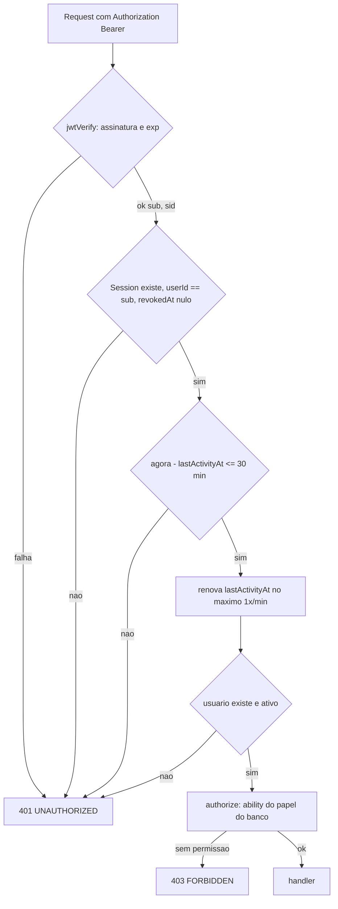

# Admin Authentication Design

**Spec**: `.specs/features/admin-authentication/spec.md`
**Status**: Draft

---

## Architecture Overview

Três endpoints no módulo `auth` (routes → controller → service → repository → schemas). O login valida
credenciais e cria uma linha `Session`; o JWT (`sub`, `sid`) é assinado no controller. O plugin `auth`
já existente passa a validar a sessão em cada request autenticada, e `authorize` (CASL) segue igual.
Decisões aprovadas: sessões no PostgreSQL (AD-001) e erros em `ErrorResponse` (AD-002).

```mermaid
sequenceDiagram
    participant C as Cliente
    participant R as auth.routes
    participant K as auth.controller
    participant S as auth.service
    participant P as auth.repository (Prisma)

    C->>R: POST /auth/login {email, password}
    R->>K: body validado (Zod)
    K->>S: login(email, password, now)
    S->>P: findUserByEmail
    alt e-mail inexistente
        S->>S: bcrypt.compare(dummyHash)
        S-->>K: InvalidCredentialsError (401)
    else lockedUntil > agora
        S-->>K: AccountLockedError (423)
    else senha errada
        S->>P: failedLoginAttempts += 1 (atomico); se >= 5, lockedUntil
        S-->>K: InvalidCredentialsError (401)
    else ok
        S->>P: reset contadores, lastLoginAt, create Session
        S-->>K: {user, sessionId}
        K->>K: reply.jwtSign({sub, sid}, expiresIn 8h)
        K-->>C: 200 {accessToken, expiresIn: 1800, user}
    end
```



Regras (bloqueio, sessão, inatividade) rodam no `auth.service` e no plugin `auth`, camadas que os testes
do repo alcançam (Vitest + `fastify.inject`, com Prisma simulado em memória).

---

## Code Reuse Analysis

### Existing Components to Leverage

| Component | Location | How to Use |
| --- | --- | --- |
| Plugin `auth` (`getCurrentUserId`, `getCurrentUser`, `getAbility`) | `apps/api/src/http/middlewares/auth.ts` | Estender com a validação de sessão e `getCurrentSessionId`. |
| `authorize(action, subject)` | `apps/api/src/http/middlewares/authorize.ts` | Sem alteração; protege as rotas `/admin/*`. |
| `getUserPermissions` / `defineAbilityFor` | `apps/api/src/utils/get-user-permissions.ts`, `packages/auth` | Sem alteração; ability pelo papel do banco. |
| `errorHandler` + `UnauthorizedError`/`ForbiddenError`/`BadRequestError`/`NotFoundError` | `apps/api/src/http/error-handler.ts`, `http/routes/_errors/*` | Estender para `ErrorResponse` (AD-002) e acrescentar dois erros. |
| Padrão `withTypeProvider<ZodTypeProvider>()` + schemas Zod | `apps/api/src/modules/services/services.routes.ts` | Mesmo padrão nas rotas `auth`. |
| `routes` (compiladores Zod no escopo) | `apps/api/src/http/routes.ts` | Registrar `authRoutes` aqui; já aplica os compiladores. |
| Padrão de teste `fastify.inject` + `vi.mock('../lib/prisma')` | `apps/api/src/http/{authorization,public-routes}.test.ts` | Mesmo padrão; fake de Prisma em memória para estado. |
| `bcryptjs` | dependência da API; usado pelo seed (custo 10) | `bcrypt.compare`; hash fictício para timing. |
| Seed | `apps/api/prisma/seed.ts` | Sem alteração; usuários de teste do login. |

### Integration Points

| System | Integration Method |
| --- | --- |
| PostgreSQL / Prisma | Novo model `Session` com relação a `User`; `User` guarda `failedLoginAttempts`, `lockedUntil`, `lastLoginAt` (já existem). |
| `@fastify/jwt` | `reply.jwtSign({ sub, sid }, { expiresIn: '8h' })` no login; `request.jwtVerify` já usado no plugin. |
| CASL (`@saas/auth`) | Inalterado; o plugin entrega `request.getAbility()` com o papel lido do banco. |
| Frontend | Contrato descrito no spec (Frontend Integration); sem código nesta feature. |

---

## Components

### Session (Prisma)

- **Purpose**: guardar a sessão para revogar no logout e medir inatividade.
- **Location**: `apps/api/prisma/schema.prisma` + migration.
- **Interfaces**: model `Session` (ver Data Models); `User.sessions Session[]`.
- **Dependencies**: `User`.
- **Reuses**: convenções do schema (`@map` snake_case, `Timestamptz(3)`, uuid com `gen_random_uuid()`).

### Constantes de auth

- **Purpose**: valores aprovados em um só lugar.
- **Location**: `apps/api/src/modules/auth/auth.constants.ts`.
- **Interfaces**: `MAX_FAILED_ATTEMPTS = 5`, `LOCK_DURATION_MS = 15 min`, `INACTIVITY_WINDOW_MS = 30 min`, `EXPIRES_IN_SECONDS = 1800`, `TOKEN_MAX_AGE = '8h'`, `ACTIVITY_THROTTLE_MS = 60 s`, `DUMMY_PASSWORD_HASH` (hash bcrypt custo 10 de um valor aleatório).
- **Dependencies**: nenhuma.
- **Reuses**: n/a.

### Schemas (`auth.schemas.ts`)

- **Purpose**: contratos Zod de entrada e saída.
- **Location**: `apps/api/src/modules/auth/auth.schemas.ts`.
- **Interfaces**: `LoginBodySchema` (`email` e-mail, `password` string não vazia), `UserSchema` (`id` uuid, `name`, `email`, `role` enum `attendant|manager`, `active`), `LoginResponseSchema` (`accessToken`, `expiresIn` inteiro, `user`).
- **Dependencies**: Zod.
- **Reuses**: padrão de schemas dos módulos `services`/`locations`.

### `auth.repository.ts`

- **Purpose**: acesso ao Prisma para login e sessões.
- **Location**: `apps/api/src/modules/auth/auth.repository.ts`.
- **Interfaces**:
  - `findUserByEmail(email)`; `resetLock(userId)` (`failedLoginAttempts = 0`, `lockedUntil = null`).
  - `incrementFailedAttempts(userId): Promise<number>` via `update` com `{ increment: 1 }` (atômico) devolvendo o novo valor; `setLockedUntil(userId, date)`.
  - `markLoginSuccess(userId, now)` (zera contadores, limpa bloqueio, `lastLoginAt`).
  - `createSession(userId, now)`, `findSessionById(id)`, `touchSession(id, now)`, `revokeSession(id, now)`.
- **Dependencies**: `prisma`.
- **Reuses**: `../../lib/prisma` (import relativo).

### `auth.service.ts`

- **Purpose**: regras de login, bloqueio, sessão e logout.
- **Location**: `apps/api/src/modules/auth/auth.service.ts`.
- **Interfaces**:
  - `login(email, password, now = new Date()): Promise<{ user: PublicUser; sessionId: string }>`; e-mail normalizado com `trim().toLowerCase()`; lança `InvalidCredentialsError` / `AccountLockedError`.
  - `validateSession(sessionId, userId, now = new Date()): Promise<void>`; lança `UnauthorizedError`; renova `lastActivityAt` se passou `ACTIVITY_THROTTLE_MS`.
  - `logout(sessionId, now = new Date()): Promise<void>`.
- **Dependencies**: repository, constantes, `bcryptjs`.
- **Reuses**: `UnauthorizedError`.

### `auth.controller.ts` e `auth.routes.ts`

- **Purpose**: HTTP: validar, assinar token, responder.
- **Location**: `apps/api/src/modules/auth/`.
- **Interfaces**:
  - `POST /auth/login` (público): chama `login`, assina `{ sub, sid }` com `expiresIn: '8h'`, responde 200 `{ accessToken, expiresIn: 1800, user }`; registra `request.log.info({ event, userId })` em sucesso, falha e bloqueio.
  - `POST /auth/logout`: `request.getCurrentSessionId()` + `logout`; responde 204.
  - `GET /auth/me`: `request.getCurrentUser()` → `UserSchema`.
- **Dependencies**: service, plugin `auth`.
- **Reuses**: padrão de rotas com Zod.

### Plugin `auth` (estendido)

- **Purpose**: autenticar com sessão válida.
- **Location**: `apps/api/src/http/middlewares/auth.ts` e `apps/api/@types/fastify.d.ts`.
- **Interfaces**: `getCurrentUserId()` passa a validar `sid` (exigido) via `validateSession`; novo `getCurrentSessionId()`; as duas compartilham uma resolução memoizada por request (uma leitura de sessão por request). `getCurrentUser`/`getAbility` inalterados.
- **Dependencies**: `auth.service`.
- **Reuses**: o próprio plugin.

### `errorHandler` (estendido)

- **Purpose**: `ErrorResponse` para 400, 401, 403 e os novos 401/423 (AD-002).
- **Location**: `apps/api/src/http/error-handler.ts`, `http/routes/_errors/invalid-credentials-error.ts`, `account-locked-error.ts`.
- **Interfaces**: `InvalidCredentialsError` → 401 `INVALID_CREDENTIALS`; `AccountLockedError` → 423 `ACCOUNT_LOCKED`; `UnauthorizedError` → 401 `UNAUTHORIZED`; `ForbiddenError` → 403 `FORBIDDEN`; erro de validação Zod (inclui `hasZodFastifySchemaValidationErrors`) e `BadRequestError` → 400 `VALIDATION_ERROR` com `details`. Demais ramos (404, 4xx genérico, 500) não mudam.
- **Dependencies**: `fastify-type-provider-zod`.
- **Reuses**: o handler existente.

### Fake de Prisma para testes

- **Purpose**: estado em memória (usuários, sessões) com as operações usadas (`findUnique`, `update` com `increment`, `create`, `findFirst`) para testar bloqueio, concorrência e inatividade sem banco.
- **Location**: `apps/api/src/test/fake-prisma.ts`.
- **Interfaces**: `createFakePrisma(seed)` → objeto compatível com o `prisma` mockado, mais acesso ao estado para asserções.
- **Dependencies**: nenhuma.
- **Reuses**: padrão `vi.mock('../lib/prisma')`.

---

## Data Models

```prisma
model Session {
  id             String    @id @default(dbgenerated("gen_random_uuid()")) @db.Uuid
  userId         String    @map("user_id") @db.Uuid
  lastActivityAt DateTime  @default(now()) @map("last_activity_at") @db.Timestamptz(3)
  revokedAt      DateTime? @map("revoked_at") @db.Timestamptz(3)
  createdAt      DateTime  @default(now()) @map("created_at") @db.Timestamptz(3)

  user User @relation(fields: [userId], references: [id], onDelete: Cascade)

  @@index([userId])
  @@map("sessions")
}
```

`User` ganha `sessions Session[]`. Nenhum campo de `User` muda.

---

## Error Handling Strategy

| Error Scenario | Handling | User Impact |
| --- | --- | --- |
| E-mail inexistente ou senha errada | `InvalidCredentialsError` → 401 `INVALID_CREDENTIALS` (mesmo corpo) | "E-mail ou senha inválidos" |
| Usuário inativo | `InvalidCredentialsError`; contadores intactos | igual ao anterior |
| Conta bloqueada | `AccountLockedError` → 423 `ACCOUNT_LOCKED` | "Conta bloqueada temporariamente" |
| Corpo inválido | Erro de validação Zod → 400 `VALIDATION_ERROR` | campos com `details` |
| Token ausente, inválido, expirado, sessão revogada/inativa, usuário inativo | `UnauthorizedError` → 401 `UNAUTHORIZED` | redireciona para login |
| Sem permissão | `ForbiddenError` → 403 `FORBIDDEN` | inalterado |
| Falha de banco no login | erro não tratado → 500 sem detalhes, sem token | "Erro interno" |

---

## Risks & Concerns

| Concern | Location | Impact | Mitigation |
| --- | --- | --- | --- |
| Tokens sem `sid` deixam de ser aceitos; os testes existentes (`auth.test.ts`, `authorization.test.ts`, `attendance.test.ts`) assinam só `{ sub }` e simulam só `prisma.user` | `http/middlewares/auth.ts` e os 3 testes | Gate quebraria na tarefa do middleware | Na T12, adaptar **somente o arranjo** (token com `sid`, mock de `prisma.session`); asserções e contagem de testes ficam iguais. Sinalizado para aprovação das tasks. |
| `errorHandler` muda o corpo de 400/401/403 | `error-handler.ts` | Clientes que liam `errors` (400) perdem a chave | Os testes atuais só conferem status; corpo novo traz `details`. Mesmos status codes (AD-002). |
| O Fastify roda sem logger (`fastify()` puro), então `request.log` não imprime | `http/server.ts` | AC de log (AUTHN-60) sem efeito em produção | T15 habilita `logger` no `server.ts` (uma linha); o teste injeta um stream para capturar. |
| Escrita de `lastActivityAt` a cada request pesaria no banco | `auth.service.validateSession` | Carga de escrita | Atualizar no máximo 1 vez por minuto (`ACTIVITY_THROTTLE_MS`). |
| Dois logins simultâneos com senha errada poderiam perder contagem | `auth.repository.incrementFailedAttempts` | Bloqueio atrasado | Incremento atômico (`update` com `increment`) e decisão de bloquear sobre o valor devolvido; `lockedUntil` é idempotente. |
| Timing revela e-mail inexistente | `auth.service.login` | Enumeração de contas | `bcrypt.compare` contra `DUMMY_PASSWORD_HASH` quando o usuário não existe. |
| `423` revela que o e-mail existe | contrato OpenAPI | Enumeração parcial | Aceito (previsto no OpenAPI, registrado no spec). |
| `JWT_SECRET` sem tamanho mínimo; `.env.example` vazio | `packages/env/index.ts` | Segredo fraco em produção | Fora do escopo; registrado no spec. |
| `docs/capim-dourado.dbml` não conhece `Session` | docs | Documentação desatualizada | Registrar como pendência ao final; não altera comportamento. |
| Migration exige o PostgreSQL local ativo (porta 5433) e `.env` | T1 | Falha da tarefa sem banco | Container `hackathon-postgres` está ativo; se falhar, parar e avisar. |

---

## Tech Decisions

| Decision | Choice | Rationale |
| --- | --- | --- |
| Sessão | Tabela `Session`, JWT com `sid` (AD-001) | Revogação e inatividade reais só com PostgreSQL |
| Teto do JWT | `exp` de 8 h, definido na assinatura (`jwtSign`), sem mexer no `server.ts` | O teto vale por token; `expiresIn` da resposta (1800) é a janela de inatividade |
| Incremento de tentativas | `update` com `{ increment: 1 }` e bloqueio sobre o valor devolvido | Atômico sem SQL cru |
| Renovação de atividade | No máximo 1 vez por minuto | Limita escritas |
| E-mail | `trim().toLowerCase()` na busca; o seed grava minúsculo | Evita duplicidade por caixa |
| Papel | Só `sub`/`sid` no token; papel lido do banco | Não confiar no cliente |
| Logs | `request.log.info({ event, userId })`; logger habilitado no `server.ts` | Eventos sem credenciais (AUTHN-60) |
| `ErrorResponse` | 400/401/403/423 (AD-002) | Contrato do OpenAPI |
