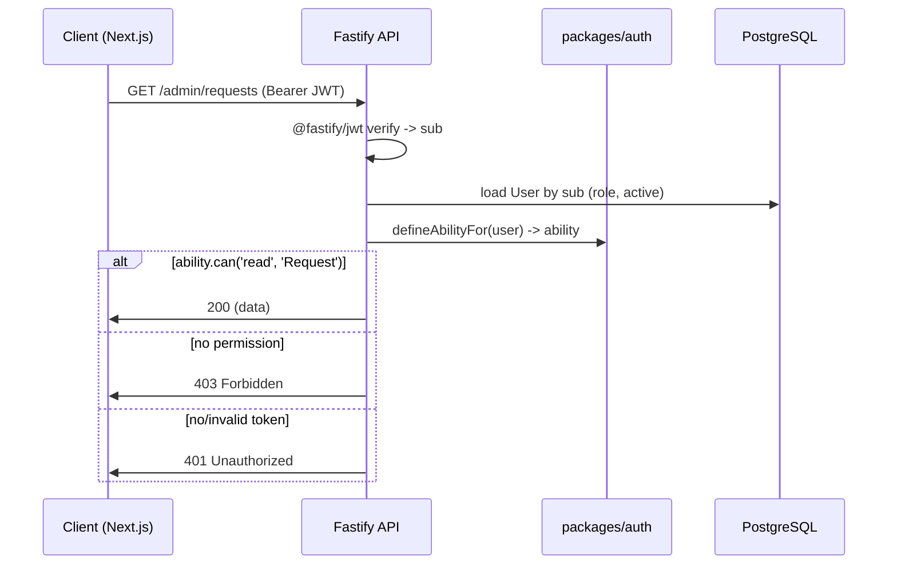

# Authorization (CASL) Design

**Spec**: `.specs/features/authorization-casl/spec.md`
**Status**: Draft

---

## Architecture Overview

O pacote `@saas/auth` é a **fonte única** das definições de autorização. O backend
constrói a ability por requisição a partir do usuário carregado do banco e a usa no
`preHandler` de cada rota administrativa. O frontend constrói a mesma ability no cliente
para controlar a interface. Nenhuma regra de autorização é duplicada.



---

## Code Reuse Analysis

### Existing Components to Leverage

| Component | Location | How to Use |
| --- | --- | --- |
| `defineAbilityFor` + `createAppAbility` (CASL wiring) | `packages/auth/src/index.ts` | Manter a assinatura e o `detectSubjectType`; trocar roles/subjects/actions. |
| `AbilityBuilder` / `createMongoAbility` | `@casl/ability` | Já é a base do pacote; manter. |
| Middleware JWT `@fastify/jwt` | `apps/api/src/http/server.ts` | Já registrado; reutilizar para extrair `sub`. |
| `PrismaClient` | `apps/api/src/lib/prisma.ts` | Reutilizar para carregar o usuário. |
| `error-handler.ts` | `apps/api/src/http/error-handler.ts` | Reescrever para mapear 401/403/400/500. |

### Integration Points

| System | Integration Method |
| --- | --- |
| Fastify routes | `preHandler` chama `ability.can(action, subject)` antes do controller. |
| `@saas/auth` → `apps/api` | `import { defineAbilityFor } from '@saas/auth'` (workspace `@saas/auth`). |
| `@saas/auth` → `apps/web` | Mesmo import; ability construída no cliente a partir do usuário autenticado. |
| Prisma | `User.role` e `User.active` alimentam `defineAbilityFor` e o check de inatividade. |

---

## Components

### Roles / Actions / Subjects (types)

- **Purpose**: vocabulário tipado e único (roles, actions, subjects).
- **Location**: `packages/auth/src/role.ts`, `src/actions.ts`, `src/subjects/`.
- **Interfaces**:
  - `type Role = 'attendant' | 'manager'`
  - `type Action = 'read' | 'create' | 'update' | 'updateStatus' | 'sendMessage' | 'pickup' | 'return' | 'match' | 'deliver' | 'close'`
  - `type SubjectName = 'Request' | 'Reservation' | 'FoundItem' | 'LostReport' | 'Equipment' | 'Location' | 'User' | 'ReservationSettings' | 'Indicator'`
  - `RequestSubject = { __typename: 'Request'; status: RequestStatus }` (necessário para a condition de reabertura)
- **Dependencies**: nenhuma externa além de `zod`.
- **Reuses**: padrão atual `subjects/user.ts` (object subject com `__typename`).

### User model

- **Purpose**: shape mínimo do usuário autenticado para a ability.
- **Location**: `packages/auth/src/models/user.ts`.
- **Interfaces**: `userSchema = { __typename?: 'User'; id: string; role: Role }`.
- **Dependencies**: `role.ts`.
- **Reuses**: padrão atual, trocando `profile` por `role`.

### Permissions / ability builder

- **Purpose**: regras por papel e construção da ability.
- **Location**: `packages/auth/src/permissions.ts`, `src/index.ts`.
- **Interfaces**:
  - `defineAbilityFor(user: User): AppAbility`
  - `createAppAbility: CreateAbility<AppAbility>`
  - `permissions: Record<Role, (user, builder) => void>`
- **Dependencies**: `@casl/ability`, `role.ts`, `actions.ts`, `subjects/`, `models/user.ts`.
- **Reuses**: `AbilityBuilder` + `detectSubjectType` atuais.

### Auth middleware (backend)

- **Purpose**: JWT → carrega `User` → anexa `request.user` e `request.ability`.
- **Location**: `apps/api/src/http/middlewares/auth.ts`.
- **Interfaces**: `getCurrentUserId(): Promise<string>`, `getAbility(): AppAbility` (ou `request.ability`).
- **Dependencies**: `@fastify/jwt`, `@saas/auth`, `@/lib/prisma`, erros 401/403.
- **Reuses**: `fastify-plugin` e o hook `preHandler` atuais.

### Error classes + handler (backend)

- **Purpose**: erros tipados 401/403/400 e handler central.
- **Location**: `apps/api/src/http/routes/_errors/`, `apps/api/src/http/error-handler.ts`.
- **Interfaces**: `UnauthorizedError`, `ForbiddenError`, `BadRequestError`.
- **Dependencies**: nenhuma externa.
- **Reuses**: padrão atual de imports (hoje quebrado; corrigir).

### Frontend ability helper

- **Purpose**: construir a ability no cliente e prover via hook/context.
- **Location**: `apps/web/src/lib/ability.ts`, `apps/web/src/lib/ability-context.tsx`.
- **Interfaces**: `getAbility(user): AppAbility`, `useAbility(): AppAbility`.
- **Dependencies**: `@saas/auth`.
- **Reuses**: `defineAbilityFor` (mesma função do backend).

---

## Data Models

### User (ability context)

```typescript
interface User {
  __typename?: 'User'
  id: string
  role: 'attendant' | 'manager'
}
```

### RequestSubject (condition de reabertura)

```typescript
type RequestStatus =
  | 'reserved' | 'picked_up' | 'returned' | 'no_show'
  | 'registered' | 'searching' | 'possible_match' | 'ready_for_pickup'
  | 'delivered' | 'closed_not_found'
  | 'open' | 'in_progress' | 'answered' | 'closed'
  | 'cancelled'

interface RequestSubject {
  __typename: 'Request'
  status: RequestStatus
}
```

A lista `FINAL_REQUEST_STATUSES` é derivada de `RequestStatus` (conjunto a confirmar via
P2 na spec).

---

## Error Handling Strategy

| Error Scenario | Handling | User Impact |
| --- | --- | --- |
| Token ausente/inválido | `UnauthorizedError` → 401 | "não autenticado" |
| Papel sem permissão | `ForbiddenError` → 403 | "sem permissão" |
| Zod validation | `ZodError` → 400 | "validação" |
| Erro inesperado | fallback → 500 | "erro interno" |

---

## Risks & Concerns

| Concern | Location | Impact | Mitigation |
| --- | --- | --- | --- |
| Middleware/error-handler/types referenciam entidades do template (`Membership`, `Organization`) | `apps/api/src/http/middlewares/auth.ts`, `apps/api/src/http/error-handler.ts`, `apps/api/@types/fastify.d.ts` | Não compilam contra o schema atual | Reescrever integralmente (T5/T6) |
| `get-user-permissions.ts` usa `Role` (inexistente) e `profile` | `apps/api/src/utils/get-user-permissions.ts` | Quebra typecheck | Reescrever (T6) |
| ESLint com typo `@rockeatseat` | `config/eslint-config/*.js` | `lint` não resolve | Fora do escopo; usar `tsc --noEmit` no Build gate |
| Nenhum test framework | repo | Sem testes hoje | Adicionar Vitest (T1) e co-localizar testes |
| `found-items` module ausente | `apps/api/src/modules/` | Rota `/admin/found-items` sem módulo | Criar o módulo na tarefa de rotas (T8) |
| `trancking` (typo) | `apps/api/src/modules/trancking` | Módulo público com nome errado | Fora do escopo (não é rota administrativa) |
| `@prisma/client` sem `prisma generate` | `apps/api` | Tipos `UserRole`/`User` indisponíveis | Pré-requisito (gerar client antes de T5/T6) |

---

## Tech Decisions

| Decision | Choice | Rationale |
| --- | --- | --- |
| Reabertura | condition CASL em `updateStatus` (`status` não-final para attendant) | reabrir não é endpoint distinto; mantém actions mínimas |
| `manage`/`delete` | não usados | domínio usa inativação (`update`), não exclusão; actions explícitas são auditáveis |
| Subject `Message` | descartado | `sendMessage` sobre `Request`; mensagens só existem no contexto de uma solicitação |
| Papéis Visitante/Sistema | fora do CASL | não são papéis administrativos |
| Test runner | Vitest | repo sem testes; leve e compatível com TS/ESM |
