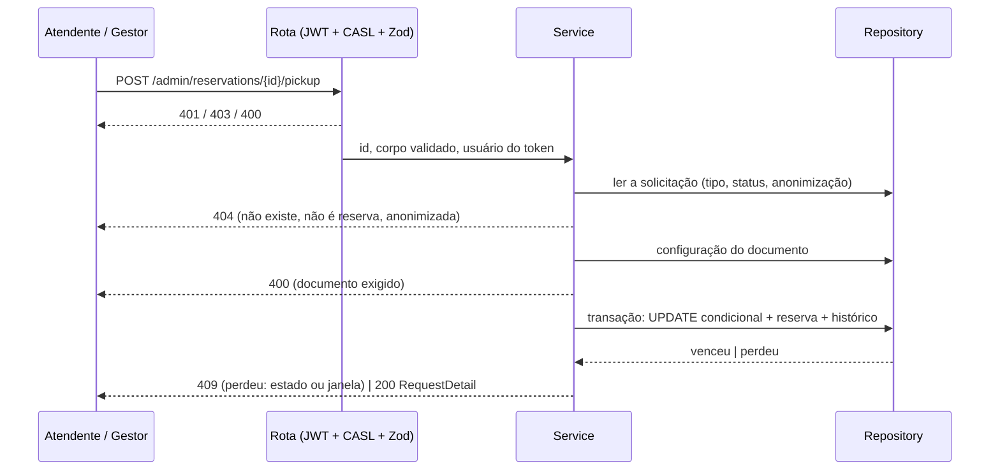

# Equipment Operations Design

**Spec**: `.specs/features/equipment-operations/spec.md`
**Status**: Approved
**Approved**: 2026-11-14 - user: "aprovo"

---

## Architecture Overview

Três rotas administrativas num módulo novo `equipment-operations` (Q1), no padrão routes → controller →
service → repository → schemas, mais o job de não comparecimento em `src/jobs/`. Toda mudança de status
é **um `updateMany` condicional dentro de uma transação**, seguido da escrita do restante e do histórico:
quem atualiza 1 linha venceu, quem atualiza 0 linhas relê e responde `404` ou `409`. A lógica de horário
(blocos, unidades livres, fuso) é reaproveitada de `reservations.slots`, sem cópia; só o que é novo e
puro (sinais de atraso, janela da retirada, montagem dos blocos da agenda) fica num arquivo sem banco.

---

## Code Reuse Analysis

### Existing Components to Leverage

| Componente | Local | Uso |
| --- | --- | --- |
| `freeUnits`, `buildBlocks`, `localDateToUtc`, `localWeekday`, `localDateOf` | `modules/reservations/reservations.slots.ts` | Blocos e unidades livres da agenda. `buildBlocks(date, opening, settings, now)` com `now` = início do dia local devolve o dia inteiro (nenhum bloco passado, data dentro da janela), sem criar outra função de blocos. |
| `reservationsRepository` (`getSettings`, `getOpeningHour`, `getEquipmentUnits`, `findActiveReservations`) | `modules/reservations/reservations.repository.ts` | Leituras idênticas às do fluxo público; evita repetir as quatro consultas. |
| `authorize`, `auth` (plugin), `getCurrentUserId` | `http/middlewares/*` | Autenticação (401) e permissão CASL (403) sem mudança. |
| `AppError`, `NotFoundError`, `errorHandler` | `http/routes/_errors/*`, `http/error-handler.ts` | `409 INVALID_STATUS_TRANSITION`, `404 NOT_FOUND`, `400 VALIDATION_ERROR`. |
| `test-db.ts` | `src/test/test-db.ts` | Banco `hackathon_test`; ganha usuário e sessão de teste (T1). |
| `lost-reports.schemas` (limpeza de texto) | `modules/lost-reports/lost-reports.schemas.ts` | Mesma regra de `trim` e remoção de caracteres de controle para `notes` e `conditionNotes`; se o helper não for exportável sem acoplar, copiar a regra mínima (uma linha) em vez de criar abstração. |

### Integration Points

| Sistema | Integração |
| --- | --- |
| `http/routes.ts` | Registrar `equipmentOperationsRoutes`; remover os três stubs de `reservations.routes.ts` (e o import de `authorize` se sobrar sem uso). |
| `http/server.ts` | Iniciar o job (`startNoShowJob`) depois do `listen`. |
| Prisma | `Request`, `Reservation`, `RequestHistory`, `User`, `ReservationSettings`, `JobLog`, `Equipment`, `OpeningHour`; **sem mudança de schema**. |
| Testes | Banco de teste real; arquivos de teste rodam um por vez (`vitest.config.mts`). |

---

## Components

### Lógica pura (`equipment-operations.logic.ts`)

- `isPickupOverdue(status, pickupDeadline, now)` e `isReturnOverdue(status, endAt, now)`: `reserved` e `agora > pickupDeadline`; `picked_up` e `agora > endAt`.
- `pickupWindowOpen(startAt, pickupDeadline, now)`: `startAt ≤ now ≤ pickupDeadline`.
- `assembleSlots(blocks, reservations, activeReservations, totalUnits, loanMs, slotMs)`: coloca cada reserva no bloco que contém seu `startAt`; reserva fora de todo bloco ganha um bloco próprio (`start` = seu `startAt`, `end` = `start + slotMs`); calcula `freeUnits` por bloco com `freeUnits` do fluxo público; ordena os blocos por `start` e as reservas por criação.

### Schemas (`equipment-operations.schemas.ts`)

`AgendaQuerySchema` (`date` real `YYYY-MM-DD`, `equipmentType`), `IdParamsSchema` (`id` uuid), `PickupBodySchema` (`documentChecked?` boolean, `notes?` ≤ 300, corpo opcional), `ReturnBodySchema` (`conditionNotes?` ≤ 300, corpo opcional), `AgendaSchema` e `RequestDetailSchema` de resposta (campos do OpenAPI; qualquer campo fora do schema é descartado na serialização).

### Repository (`equipment-operations.repository.ts`)

- `findAgendaReservations(type, dayStart, dayEnd)`: reservas do tipo com `startAt` no dia, todos os status, com `request` (id, protocolo, nome, status, `anonymizedAt`), em ordem de criação.
- `findOperable(id)`: solicitação com `reservation`, devolvendo `type`, `status`, `anonymizedAt`.
- `pickupTx(id, userId, data, now)` e `returnTx(id, userId, data, now)`: `prisma.$transaction`; `updateMany` condicional (`id`, `type reservation`, `status` esperado, `anonymizedAt null` e, na retirada, `reservation: { startAt ≤ now, pickupDeadline ≥ now }`); se `count = 1`: atualiza a `Reservation` e cria o `RequestHistory` (`staff`, `actorUserId`); devolve `won` ou `lost`.
- `loadDetail(id)`: solicitação completa para o `RequestDetail` (visitante, reserva com local atual, histórico com o nome do usuário).
- `markNoShowsTx(now)`: transação: ids elegíveis (`status reserved`, `pickupDeadline < now`) em ordem crescente; para cada id, `updateMany` condicional (`status reserved`, `pickupDeadline < now`) com `status no_show` e `completedAt`; só `count = 1` cria o histórico (`system`, sem usuário); devolve a quantidade.
- `logJob(name, status, affected, error, startedAt)`: grava `job_logs`.

### Mapper (`equipment-operations.mapper.ts`)

Monta o `RequestDetail` de uma reserva: `visitor`, `reservation` (com `pickupOverdue`/`returnOverdue`), `history` com `actor { type, userId, name }`, `lostReport` e `sacMessage` nulos, `messages` vazia. Reaproveitado depois pelo `GET /admin/requests/{id}` (RF14).

### Service (`equipment-operations.service.ts`)

- `getAgenda(date, type, now)`: configuração e expediente do dia; blocos (`buildBlocks` com `now` = início do dia); reservas do dia; reservas ativas na janela; `assembleSlots`.
- `registerPickup(id, userId, input, now)`: `findOperable` (404 se não existir, não for reserva ou estiver anonimizada); documento exigido e não confirmado → `AppError(400, 'VALIDATION_ERROR')`; `pickupTx`; se perdeu, relê e responde `409 INVALID_STATUS_TRANSITION` com mensagem por motivo (status, antes do bloco, depois da tolerância) ou `404` se sumiu; sucesso devolve o detalhe.
- `registerReturn(id, userId, input, now)`: igual, com `picked_up` → `returned` e `completedAt`.
- `markNoShows(now)`: chama `markNoShowsTx`.
- O `now` entra por parâmetro (relógio injetável nos testes); as rotas passam `new Date()`.

### Controller e rotas (`equipment-operations.controller.ts`, `.routes.ts`)

Controllers leem os dados já validados, pegam `request.getCurrentUserId()` e chamam o service. Rotas com `preHandler: authorize('read'|'pickup'|'return', 'Reservation')`, `schema` Zod (params, query, body opcional, resposta `200`).

### Job (`src/jobs/mark-no-show.ts`)

- `runMarkNoShow(now)`: chama `markNoShows`, e grava `job_logs` (`mark-no-show`) só se afetou reservas ou falhou; erro registrado com `name`/`code`, nunca a mensagem.
- `startNoShowJob()`: `setInterval` de 60 s com `unref()` e uma flag que pula a execução se a anterior ainda roda; é iniciado em `server.ts`.

---

## Data Models

Nenhum modelo novo. Gravações por operação:

| Operação | `requests` | `reservations` | `request_history` | `job_logs` |
| --- | --- | --- | --- | --- |
| Retirada | `status = picked_up` | `picked_up_at`, `document_checked`, `pickup_notes` | `reserved → picked_up`, `staff`, usuário | - |
| Devolução | `status = returned`, `completed_at` | `returned_at`, `return_notes` | `picked_up → returned`, `staff`, usuário | - |
| Não comparecimento | `status = no_show`, `completed_at` | - | `reserved → no_show`, `system`, sem usuário | uma linha se afetou ou falhou |

---

## Error Handling Strategy

| Situação | Resposta |
| --- | --- |
| Sem token, token inválido, sessão revogada ou inativa | `401 UNAUTHORIZED` (plugin `auth`) |
| Sem a ability | `403 FORBIDDEN` (`authorize`) |
| Parâmetro, corpo ou `id` inválido | `400 VALIDATION_ERROR` (Zod) |
| Documento exigido e não confirmado | `400 VALIDATION_ERROR` |
| Id inexistente, que não é reserva ou anonimizado | `404 NOT_FOUND` |
| Status errado, antes do bloco ou depois da tolerância, ou corrida perdida | `409 INVALID_STATUS_TRANSITION` |
| Falha na transação | `500 INTERNAL_ERROR`, nada gravado |

---

## Risks & Concerns

| Risco | Mitigação |
| --- | --- |
| Retirada x job com relógios diferentes | A retirada exige `pickupDeadline ≥ agora` e o job `pickupDeadline < agora` nos próprios `UPDATE`; qualquer interleaving deixa uma só transição; teste com relógios distintos. |
| Dois jobs travando linhas em ordens diferentes (deadlock) | Ids elegíveis em ordem crescente e `updateMany` por linha. |
| `setInterval` dentro do processo some se o processo cair | Aceito (uso local); a próxima execução recupera tudo que venceu. |
| Mudança do corpo opcional (`undefined`) | `body` opcional no schema; teste com e sem corpo. |
| Teste de 403 (todo papel tem a ability) | O teste substitui `getUserPermissions` por uma ability sem direitos; as abilities reais já são provadas em `authorization-casl`. |
| Usuário de teste e sessões no banco de teste | `resetTestDb` passa a truncar `users`/`sessions`; os outros arquivos de banco não dependem deles. |

---

## Tech Decisions

| Decisão | Escolha | Por quê |
| --- | --- | --- |
| Concorrência | `updateMany` condicional por linha, sem `pg_advisory_xact_lock` | A operação só reduz uso; o Postgres já serializa por linha (mesmo padrão do cancelamento) |
| Job | Um `updateMany` por linha elegível, dentro de uma transação | Sem SQL cru; conta exatamente o que mudou e cria histórico só para essas |
| Agenda do dia inteiro | `buildBlocks` com `now` no início do dia | Reuso sem tocar `reservations.slots` |
| Reuso do repository de reservas | Importar as quatro leituras | Evita duplicar consultas; o módulo novo não importa o service nem as escritas de reservas |
| Relógio | `now` por parâmetro | Testes determinísticos |
| Detalhe | Mapper no módulo, resposta fixa de reservas | Reaproveitável pelo RF14 sem abstração genérica agora |
