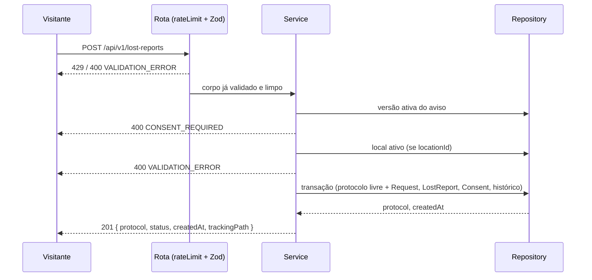

# Lost Item Registration Design

**Spec**: `.specs/features/lost-item-registration/spec.md`
**Status**: Approved
**Approved**: 2026-11-14 - user: "aprovo"

---

## Architecture Overview

Um endpoint público no módulo `lost-reports` (Q1), no padrão modular do backend: routes → controller →
service → repository, com **Zod** nos schemas ligados à rota. Toda regra que só olha o corpo (obrigatórios,
formatos, limites, data, exclusividade do local, `trim`) fica no schema Zod; o service só decide o que
depende do banco (versão do aviso, local ativo); o repository grava tudo numa transação. Construção
simples: nenhuma dependência nova, nenhuma tabela nova, sem mexer em `reservations`.

---

## Code Reuse Analysis

### Existing Components to Leverage

| Componente | Local | Uso |
| --- | --- | --- |
| `generateProtocol` | `utils/protocol.ts` | Protocolo `CAP-XXXX-XXXX`; checagem prévia no repository, como em `reservations`. |
| `rateLimit` | `http/middlewares/rate-limit.ts` | `onRequest`, 10/min por IP (LIR-11). |
| `AppError` | `http/routes/_errors/app-error.ts` | `CONSENT_REQUIRED` e `VALIDATION_ERROR` do service. |
| `localDateOf` | `modules/reservations/reservations.slots.ts` | Data local (`America/Araguaina`) para "hoje" na regra de data futura. |
| `privacyRepository.findActive` | `modules/privacy/privacy.repository.ts` | Versão ativa do aviso. |
| `fastify-type-provider-zod` / `errorHandler` | `http/error-handler.ts` | Erros do Zod viram `400 VALIDATION_ERROR` com `details`. |
| `test-db.ts` | `src/test/test-db.ts` | Banco `hackathon_test`, `resetTestDb`, `testPrisma`. |

### Integration Points

| Sistema | Integração |
| --- | --- |
| `http/routes.ts` | `lostReportsRoutes` já está registrado; a rota nova entra no mesmo plugin (as rotas `/admin/lost-reports/*` ficam como estão). |
| Prisma | `Request`, `LostReport`, `Consent`, `RequestHistory`, `Location`, `PrivacyNotice`; **sem mudança de schema**. |
| Testes | `vitest.config.ts` novo com `fileParallelism: false`: dois arquivos de teste usam o mesmo banco de teste e um `TRUNCATE` apagaria os dados do outro. |

---

## Components

### Schemas (`lost-reports.schemas.ts`)

- `CreateLostReportSchema` (Zod): campos do OpenAPI; `name`/`description`/`identificationDetail`/`email` passam por `trim` e remoção de caracteres de controle (quebra de linha mantida nos dois textos longos) **antes** dos limites; `category` e `lostPeriod` enum; `phone` `^[0-9]{10,11}$`; `email` ≤ 255; `photoUrl` ≤ 500 e `http`/`https`; `lostDate` `YYYY-MM-DD` real e `≤` hoje local; `consent.accepted` `z.boolean()` (o `false` vira `CONSENT_REQUIRED` no service, como em reservas); `superRefine`: exatamente um entre `locationId` e `unknownLocation: true`. Campos extras: `strip` (padrão do Zod).
- `ProtocolCreatedSchema`: `protocol`, `status`, `createdAt`, `trackingPath` — é o schema de resposta `201`; qualquer outro campo é descartado na serialização (defesa de privacidade).
- Tipo `CreateLostReportInput`.

### Repository (`lost-reports.repository.ts`)

- `findActivePrivacyVersion()` (via `privacyRepository.findActive`), `findActiveLocation(id)`.
- `createLostReportTx(data)`: `prisma.$transaction`: procura protocolo livre (laço), cria `Request` (`type lost_report`, `status registered`, nome, telefone, e-mail) com `LostReport`, `Consent` (`purpose` `atender a solicitação`) e `RequestHistory` (`fromStatus null`, `toStatus registered`, `actorType visitor`) aninhados — o Prisma grava tudo ou nada.

### Service (`lost-reports.service.ts`)

`createLostReport(input)`: valida consentimento (`accepted` e versão ativa → `AppError 400 CONSENT_REQUIRED`); se `locationId`, local ativo (senão `AppError 400 VALIDATION_ERROR`); chama o repository; devolve `{ protocol, status: 'registered', createdAt, trackingPath: '/acompanhar/{protocol}' }`.

### Controller e rota

- Controller lê o corpo já validado (`request.body as CreateLostReportInput`), chama o service e responde `201`.
- Rota `POST /lost-reports` no `lostReportsRoutes`: `onRequest: rateLimit({ max: 10, windowMs: 60_000 })`, `schema: { tags, body: CreateLostReportSchema, response: { 201: ProtocolCreatedSchema } }`. As rotas públicas do `routes.ts` já definem os compiladores Zod no plugin.

### Tratamento do 500 (`http/error-handler.ts`)

Hoje o fallback responde `{ message }` e faz `console.error(error)` com o erro inteiro. Passa a responder `{ statusCode: 500, code: 'INTERNAL_ERROR', message }` (OpenAPI/AD-002) e a registrar só `name` e `code` do erro, nunca a mensagem nem o corpo (que podem trazer valores do formulário). O comportamento dos outros ramos não muda.

---

## Data Models

Nenhum modelo novo. Gravações por requisição válida:

| Tabela | Campos preenchidos |
| --- | --- |
| `requests` | `protocol`, `type=lost_report`, `status=registered`, `visitor_name`, `visitor_phone`, `visitor_email?` |
| `lost_reports` | `category`, `description`, `identification_detail?`, `photo_url?`, `location_id?`, `unknown_location`, `lost_date`, `lost_period` (`unknown` se ausente) |
| `consents` | versão do aviso, `purpose`, `accepted_at` (padrão) |
| `request_history` | `from_status` nulo, `to_status=registered`, `actor_type=visitor` |

`lost_date` é `Date`: o texto `YYYY-MM-DD` é gravado como `new Date('YYYY-MM-DDT00:00:00Z')`, sem deslocar o dia por fuso.

---

## Error Handling Strategy

| Situação | Resposta |
| --- | --- |
| Corpo inválido (Zod) | `400 VALIDATION_ERROR` com `details` |
| `accepted` falso, versão errada ou sem aviso ativo | `400 CONSENT_REQUIRED` |
| `locationId` inexistente ou inativo | `400 VALIDATION_ERROR` |
| Mais de 10 requisições por minuto por IP | `429 TOO_MANY_REQUESTS` |
| Falha na transação (rollback automático) | `500 INTERNAL_ERROR`, log só `name`/`code` |

---

## Risks & Concerns

| Risco | Mitigação |
| --- | --- |
| `photoUrl` externo gravado e aberto pela equipe (I5) | Só `http`/`https`; limite de 500; restrição à origem própria fica com a feature de upload. |
| Registros duplicados por clique duplo (Q5) | Documentado; a equipe une duplicados; limite por IP. |
| Textos livres com dados pessoais (I6) | Registrado para a feature RF31; esta feature nunca devolve os textos. |
| `vitest.config.ts` novo muda como todos os testes rodam | Só liga `fileParallelism: false`; a suíte inteira roda no gate da task. |
| Erro do Prisma pode conter valores no `message` | O handler registra só `name` e `code`. |

---

## Tech Decisions

| Decisão | Escolha | Por quê |
| --- | --- | --- |
| Onde validar | Schema Zod na rota (pedido do usuário) | Padrão do projeto; falha antes do controller. |
| Regras que olham o banco | Service | `AGENTS.MD`/`backend.md`: regra no service, Prisma só no repository. |
| Atomicidade | Gravação aninhada do Prisma (uma transação) | Simples; um passo falho desfaz tudo. |
| Reuso | Importar utilitários, não o service de reservas | Evita acoplar os dois módulos; nada de reservas muda. |
| Testes | Schema em unitário (sem banco) + rotas em integração (PostgreSQL de teste) | Regras puras rápidas; persistência e atomicidade provadas de verdade. |
