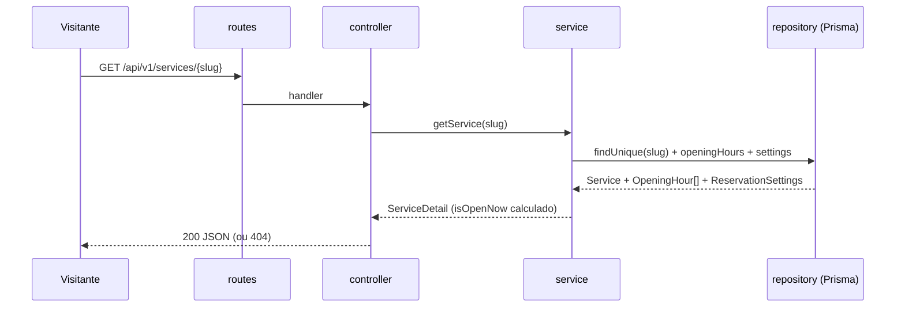

# Public Query Routes Design

**Spec**: `.specs/features/public-query-routes/spec.md`
**Status**: Approved
**Approved**: 2026-11-14 - user: "quero aprovar Design + tasks e iniciar a execute"

---

## Architecture Overview

Quatro endpoints de leitura, sem autenticação, seguindo o padrão modular existente
(routes → controller → service → repository → schemas). O `ServiceDetail` monta dados de
`Service`, `OpeningHour`, `ReservationSettings` e `Location` (via relation).

As rotas ficam sob o prefixo global `/api/v1` (registro no `routes.ts` ou no `server.ts`).

---

## Code Reuse Analysis

### Existing Components to Leverage

| Component | Location | How to Use |
| --- | --- | --- |
| Padrão de módulo (routes/controller/service/repository/schemas) | `apps/api/src/modules/*` | Seguir a mesma estrutura e convenções |
| `authorize` (CASL) | `apps/api/src/http/middlewares/authorize.ts` | **Não usado** — estas rotas são públicas |
| `errorHandler` central | `apps/api/src/http/error-handler.ts` | Reutilizar para 404/500 |
| `PrismaClient` | `apps/api/src/lib/prisma.ts` | Reutilizar nos repositories |

### Integration Points

| System | Integration Method |
| --- | --- |
| `Service.pickupLocation` | relation via Prisma `include` |
| `OpeningHour` / `ReservationSettings` | consulta direta via Prisma no repository de `services` |

---

## Components

### Módulo `services`

- **Purpose**: listar serviços ativos e detalhar um serviço por slug.
- **Location**: `apps/api/src/modules/services/`.
- **Interfaces**:
  - `routes`: `GET /api/v1/services`, `GET /api/v1/services/:slug`.
  - `controller`: `listServices`, `getService`.
  - `service`: `listServices()`, `getServiceDetail(slug)` (monta `isOpenNow`).
  - `repository`: `findManyActive()`, `findUniqueBySlug(slug)` (+ `OpeningHour.findMany`, `ReservationSettings.findUnique`).
  - `schemas`: `ServiceSchema`, `ServiceDetailSchema`.
- **Dependencies**: Prisma.
- **Reuses**: padrão de módulo.

### Módulo `locations`

- **Purpose**: listar locais ativos (público) e manter rotas admin existentes.
- **Location**: `apps/api/src/modules/locations/`.
- **Interfaces**: `routes` (`GET /api/v1/locations` + admin), `controller`, `service` (`listActive()`), `repository` (`findManyActive()`), `schemas` (`LocationSchema`).
- **Dependencies**: Prisma.
- **Reuses**: rotas admin já existentes (CASL).

### Módulo `privacy`

- **Purpose**: retornar o aviso de privacidade vigente.
- **Location**: `apps/api/src/modules/privacy/`.
- **Interfaces**: `routes` (`GET /api/v1/privacy-notice`), `controller`, `service` (`getActive()`), `repository` (`findActive()`), `schemas` (`PrivacyNoticeSchema`).
- **Dependencies**: Prisma.
- **Reuses**: padrão de módulo.

---

## Data Models (Prisma → OpenAPI mapping)

| OpenAPI schema | Fonte Prisma | Observação |
| --- | --- | --- |
| `Service` | `Service` (subset) | expõe `id, slug, name, shortDescription, icon, kind, flow, equipmentType` |
| `ServiceDetail` | `Service` + `OpeningHour[]` + `ReservationSettings` + `Location` | `isOpenNow` computado; `pickupLocation` via relation |
| `Location` | `Location` (subset) | expõe `id, name, floor, type, active` |
| `PrivacyNotice` | `PrivacyNotice` (subset) | `updatedAt` ← `publishedAt` |

`isOpenNow` é derivado de `OpeningHour` (weekday + openTime/closeTime) comparado à hora local em
`America/Araguaina` (UTC-3, sem DST).

---

## Error Handling Strategy

| Error Scenario | Handling | User Impact |
| --- | --- | --- |
| slug inexistente | `NotFoundError` → 404 `NOT_FOUND` | "serviço não encontrado" |
| sem aviso ativo | `NotFoundError` → 404 `NOT_FOUND` | "aviso não disponível" |
| erro inesperado | fallback → 500 | "erro interno" |

---

## Risks & Concerns

| Concern | Location | Impact | Mitigation |
| --- | --- | --- | --- |
| `isOpenNow` depende de fuso `America/Araguaina` | `services.service.ts` | Cálculo errado se usar fuso do servidor | Usar UTC-3 fixo (sem DST), com teste unitário |
| `updatedAt` ≠ `publishedAt` | `privacy` | Mapear o campo corretamente | Mapeamento explícito no service/controller |
| Rotas admin existentes sem prefixo `/api/v1` | `locations.routes.ts`, demais | Divergência de path | Prefixo global registra tudo sob `/api/v1` |
| `ServiceDetail` monta dados de 4 fontes | `services.repository.ts` | N+1 ou montagem incorreta | Uma consulta com `include` + duas leituras simples |

---

## Tech Decisions

| Decision | Choice | Rationale |
| --- | --- | --- |
| Prefixo `/api/v1` | prefixo global no registro das rotas | alinha com o OpenAPI |
| `isOpenNow` | calculado no `service` (não no controller) | regra de negócio |
| Leitura de `OpeningHour`/`ReservationSettings` | direto via Prisma no `services.repository` | dados de referência, sem dependência entre módulos |
| `updatedAt` | mapear `publishedAt` | o Prisma só tem `publishedAt` |
