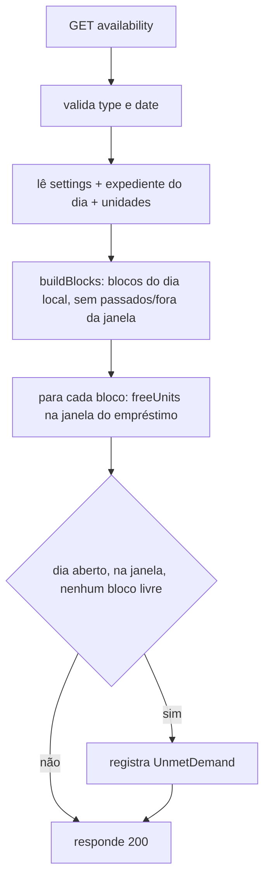

# Reservations and Availability Design

**Spec**: `.specs/features/reservations-and-availability/spec.md`
**Status**: Draft

---

## Architecture Overview

Três endpoints públicos seguindo o padrão modular (routes → controller → service → repository →
schemas). A regra de horário (blocos, janela, unidades livres) é **lógica pura** em um arquivo
sem banco, testada à parte; o repository só lê e grava; a criação roda numa transação que pega
uma trava por tipo de equipamento antes de contar. Construção simples: um erro genérico
(`AppError`) para todos os códigos novos, um limitador em memória e uma única estratégia de teste de
banco.

```mermaid
sequenceDiagram
    participant V as Visitante
    participant R as routes (+rate limit)
    participant S as reservations.service
    participant L as reservations.slots (puro)
    participant P as repository (Prisma)

    V->>R: POST /reservations
    R->>S: createReservation(input, now)
    S->>P: settings, openingHour, location, privacyNotice (leituras)
    S->>L: validar janela e alinhamento do startAt
    S->>P: $transaction
    P->>P: pg_advisory_xact_lock(tipo)
    P->>P: contar ativas do telefone/tipo; ler reservas da janela
    S->>L: freeUnits(janela, reservas, unidades)
    alt sem unidade
        S-->>V: 409 SLOT_UNAVAILABLE
    else livre
        P->>P: Request + Reservation + Consent + History
        S-->>V: 201 ReservationCreated
    end
```



Onde as regras rodam: blocos, janela e unidades livres em `reservations.slots.ts` (teste unitário);
limite por telefone, trava e transação em `reservations.service.ts`/`repository.ts` (teste de
integração contra o PostgreSQL de teste).

---

## Code Reuse Analysis

### Existing Components to Leverage

| Component | Location | How to Use |
| --- | --- | --- |
| Padrão de módulo + `withTypeProvider<ZodTypeProvider>()` | `apps/api/src/modules/services/*` | Mesmo padrão em rotas, controller e schemas |
| `errorHandler` central | `apps/api/src/http/error-handler.ts` | Ganha um ramo para `AppError` (código + status) |
| Erros existentes (`NotFoundError`, `BadRequestError`, ...) | `apps/api/src/http/routes/_errors/*` | `NotFoundError` para o 404 genérico do cancelamento |
| `routes` (compiladores Zod no escopo + prefixo `/api/v1`) | `apps/api/src/http/routes.ts` | Registrar as novas rotas |
| `prisma` singleton | `apps/api/src/lib/prisma.ts` | Repository; no teste de banco é trocado por um cliente do banco de teste |
| Rotas admin de `reservations` | `apps/api/src/modules/reservations/reservations.routes.ts` | Rotas públicas entram no mesmo plugin, ao lado das admin |
| Alfabeto de protocolo | `apps/api/prisma/seed.ts` (`ABCDEFGHJKLMNPQRSTUVWXYZ23456789`) | Mesmo alfabeto no gerador |
| Padrão de teste `fastify.inject` | `apps/api/src/http/*.test.ts` | Mesmo padrão; banco real em vez de fake |

### Integration Points

| System | Integration Method |
| --- | --- |
| PostgreSQL / Prisma | `$transaction` + `pg_advisory_xact_lock(hashtext('equipment:<tipo>'))` via `$queryRaw`; leituras de `ReservationSettings` (id 1), `OpeningHour`, `Equipment`, `Location`, `PrivacyNotice`; escrita em `Request`, `Reservation`, `Consent`, `RequestHistory`, `UnmetDemand` |
| Catálogo público (`public-query-routes`) | O formulário usa `/locations` e `/privacy-notice`; esta feature só valida o que recebe |
| Auth / CASL | Sem uso: rotas públicas, sem `authorize` |
| Schema Prisma | Sem mudança |

---

## Components

### `reservations.slots.ts` (lógica pura)

- **Purpose**: tudo que é horário e contagem, sem banco nem `Date.now()`.
- **Location**: `apps/api/src/modules/reservations/reservations.slots.ts`.
- **Interfaces**:
  - `localDateToUtc(date: string, time: string): Date` e `localWeekday(date: string): number` (UTC-3).
  - `buildBlocks(date, opening, settings, now): Block[]` — blocos `[start, end)` do dia local, da `openTime` até `closeTime − loanDurationMinutes`; remove blocos cujo fim já passou e datas além de hoje + `maxAdvanceDays`; `[]` para dia fechado ou sem linha.
  - `isWithinWindow(date, now, settings): boolean` — data aberta para consulta (hoje até hoje + `maxAdvanceDays`).
  - `freeUnits(window: {start, end}, reservations: {startAt, endAt}[], totalUnits): number` — unidades − maior simultaneidade na janela (varredura por eventos), mínimo 0.
  - `currentBlock(blocks, now): Block | undefined` — bloco que contém o instante.
  - `validateStartAt(startAt, opening, settings, now): 'ok' | 'outside_hours' | 'invalid'` — expediente/dia fechado, alinhado ao bloco, não passado, dentro da antecedência.
- **Dependencies**: nenhuma.
- **Reuses**: n/a.

### Schemas (`reservations.schemas.ts`, `tracking.schemas.ts`)

- **Purpose**: contratos Zod de entrada e saída.
- **Interfaces**: `AvailabilityParamsSchema` (`type`), `AvailabilityQuerySchema` (`date` real), `AvailabilitySchema`; `CreateReservationSchema` (regras do spec, `superRefine` para `startAt` com `scheduled` e para campos do tipo errado), `ReservationCreatedSchema`; em `tracking`: `CancelParamsSchema` (`protocol`), `CancelBodySchema` (`phone`, `reason?`), `TrackingViewSchema`.
- **Dependencies**: Zod; `LocationSchema` de `locations.schemas`.
- **Reuses**: schemas existentes de `locations`.

### Repository (`reservations.repository.ts`)

- **Purpose**: único ponto de acesso ao Prisma desta feature.
- **Interfaces**:
  - Leituras: `getSettings()`, `getOpeningHour(weekday)`, `getEquipmentUnits(type)` (soma de `quantity` ativos) e `getPickupLocation(type)` (local da primeira linha ativa do tipo), `findActiveReservations(type, from, to)` (`reserved`/`picked_up` que tocam o intervalo), `findActiveLocation(id)`, `findActivePrivacyVersion()`.
  - Escritas: `recordUnmetDemand(type, requestedFor)`; `createReservationTx(...)`: `$transaction` com `pg_advisory_xact_lock`, contagem do limite por telefone, releitura das reservas da janela, `Request` + `Reservation` + `Consent` + `RequestHistory`; devolve um resultado tipado (`created` | `limit` | `slot_unavailable`).
  - Cancelamento: `cancelReservationTx(protocol, phone, reason, now)`: `$transaction` com `updateMany` condicional (`status = reserved`) que garante uma única transição; devolve `not_found` | `not_cancellable` | `cancelled`.
- **Dependencies**: `prisma`, `protocol` util.
- **Reuses**: `../../lib/prisma`.

### Service (`reservations.service.ts`)

- **Purpose**: regras de negócio sobre o que o repository lê e grava.
- **Interfaces**:
  - `getAvailability(type, date, now = new Date())`: monta `Availability`, aplica `freeUnits` por bloco, calcula `nowAvailable` (só hoje) e registra `UnmetDemand` quando cabe; falha ao registrar não derruba a resposta.
  - `createReservation(input, now = new Date())`: valida consentimento (`CONSENT_REQUIRED`), local atual, `startAt`/modo `now` (`OUTSIDE_OPENING_HOURS` / `VALIDATION_ERROR`), chama a transação, traduz o resultado em `AppError` (`SLOT_UNAVAILABLE`, `ACTIVE_RESERVATION_LIMIT`) e monta `ReservationCreated`.
  - `cancelReservation(protocol, phone, reason, now = new Date())`: traduz o resultado do repository (`NotFoundError` genérico, `REQUEST_NOT_CANCELLABLE`) e monta a `TrackingView` da reserva.
- **Dependencies**: repository, `reservations.slots`, constantes.
- **Reuses**: `AppError`, `NotFoundError`.

### Controllers e rotas

- **Purpose**: HTTP.
- **Interfaces**: `reservations.controller.ts` (`getAvailabilityController`, `createReservationController`); `reservations.routes.ts` ganha `GET /equipment/:type/availability` e `POST /reservations` (público, `POST` com `rateLimit`); `tracking.controller.ts` (`cancelController`) e `tracking.routes.ts` com `POST /tracking/:protocol/cancel` (`rateLimit`).
- **Dependencies**: service, rate limit.
- **Reuses**: padrão de rotas dos módulos `services`/`auth`.

### Erro genérico e rate limit

- **Purpose**: códigos novos sem uma classe por código.
- **Interfaces**:
  - `AppError(statusCode, code, message)` em `http/routes/_errors/app-error.ts`; o `errorHandler` responde `{ statusCode, code, message }`.
  - `rateLimit({ max, windowMs })` em `http/middlewares/rate-limit.ts`: contador em memória por IP (janela fixa), lança `AppError(429, 'TOO_MANY_REQUESTS')`.
- **Reuses**: `errorHandler` existente.

### Utilitário de protocolo

- **Purpose**: `CAP-XXXX-XXXX` imprevisível.
- **Location**: `apps/api/src/utils/protocol.ts` — `generateProtocol()` com `crypto.randomInt` sobre o alfabeto do seed.

### Helper do banco de teste

- **Purpose**: um PostgreSQL de teste simples e isolado do banco de desenvolvimento.
- **Location**: `apps/api/src/test/test-db.ts`.
- **Interfaces**: `setupTestDb()` (lê `DATABASE_URL` do ambiente ou do `.env` da raiz, troca o nome do banco por `hackathon_test`, cria o banco se não existir e roda `prisma migrate deploy` uma vez); `resetTestDb()` (`TRUNCATE` das tabelas operacionais e semeia expediente, configurações, locais, aviso de privacidade e equipamentos mínimos); `testPrisma` (cliente do banco de teste).
- **Reuses**: `prisma migrate deploy` (migrations existentes).

---

## Data Models

Nenhuma mudança de schema. Mapeamento usado:

| Dado | Fonte |
| --- | --- |
| Unidades | Soma de `Equipment.quantity` com `active = true` do tipo |
| Janela de uma reserva | `Reservation.startAt` até `endAt` (= `startAt` + `loanDurationMinutes`, gravados) |
| Reserva ativa | `Request.status` em `reserved`/`picked_up` com `Reservation.equipmentType` do tipo |
| Limite por telefone | `Request.visitorPhone` + `type = reservation` + status ativo + `Reservation.equipmentType` (índice `visitorPhone, type, status`) |
| Local de retirada exibido | `pickupLocation` da primeira linha de `Equipment` ativa do tipo (por `createdAt`) |
| Cancelamento | `Request.status = cancelled`, `completedAt = agora`, `RequestHistory(reserved → cancelled, actor visitor, internalNote = motivo)` |

---

## Error Handling Strategy

| Error Scenario | Handling | User Impact |
| --- | --- | --- |
| `type` fora do enum, `date` inválida, corpo inválido | Zod → `400 VALIDATION_ERROR` | Campos com `details` |
| Consentimento ausente ou versão diferente da ativa | `AppError(400, 'CONSENT_REQUIRED')` | Mensagem para aceitar o aviso vigente |
| Fora do expediente ou dia fechado | `AppError(400, 'OUTSIDE_OPENING_HOURS')` | "Horário fora do expediente" |
| Passado, além da antecedência, desalinhado | `AppError(400, 'VALIDATION_ERROR')` | "Horário inválido" |
| Sem unidade no intervalo (dentro da transação) | `AppError(409, 'SLOT_UNAVAILABLE')` | "Esse horário acabou de ser reservado" |
| Limite por telefone | `AppError(409, 'ACTIVE_RESERVATION_LIMIT')` | "Você já tem uma reserva ativa" |
| Cancelamento: protocolo, telefone ou anonimizada | `NotFoundError` genérico → `404 NOT_FOUND` (mesmo corpo) | Sem revelar se o protocolo existe |
| Cancelamento: não está `reserved` (ou não é reserva) | `AppError(409, 'REQUEST_NOT_CANCELLABLE')` | "Não é possível cancelar" |
| Limite de requisições | `AppError(429, 'TOO_MANY_REQUESTS')` | "Tente novamente em instantes" |
| Falha no meio da criação | Transação desfaz tudo; `500` genérico | Nenhum `Request` órfão |

---

## Risks & Concerns

| Concern | Location | Impact | Mitigation |
| --- | --- | --- | --- |
| Trava e simultaneidade só se provam num PostgreSQL real; os testes atuais usam fake em memória | testes de `reservations` | Bug de concorrência passaria despercebido | Um arquivo de integração contra `hackathon_test` (D12); `Promise.all` de N requisições contra poucas unidades |
| O teste de banco cria um banco e roda migrations; depende do container `hackathon-postgres` (porta 5433) | `test-db.ts` | Teste falha sem o container | Falhar com mensagem clara; não pular teste |
| Dois arquivos de teste com banco rodando em paralelo se atropelariam | `apps/api/src/**/*.test.ts` | Falhas intermitentes | Todos os cenários com banco ficam em **um** arquivo (`reservations-routes.test.ts`); o resto não usa banco |
| Relógio fixo com `vi.useFakeTimers({ toFake: ['Date'] })` convive com o cliente do banco | testes com `now` | Quebra de timeouts do driver | Fingir só `Date`; o service aceita `now` injetável para os unitários |
| A consulta do dia em andamento lista o bloco atual, mas `scheduled` exige `startAt` ≥ agora (D2) | `getAvailability` / `validateStartAt` | O bloco em andamento aparece livre e só serve para `mode=now` | Comportamento aprovado; a UI usa `nowAvailable`/`mode=now` para o bloco atual |
| `picked_up` que passou do `endAt` sem devolução deixa de contar nos blocos futuros | `freeUnits` | Unidade fora aparece livre | Limitação aceita e registrada no spec (RF03 só fala em sobreposição) |
| Capacidade por tipo permite mais reservas "infantil" que cadeiras infantis | D5 | Superlotação de um tamanho | Limitação aceita; mudança de schema fica para uma feature futura |
| Limite em memória some a cada reinício e não vale entre instâncias | `rate-limit.ts` | Sem proteção persistente | Aceito: apresentação local, uma instância |
| Pasta `trancking` (typo) tem imports e arquivos vazios | `modules/trancking/*` | Renomear quebra imports (não há nenhum hoje) | `git mv` na primeira tarefa do módulo, confirmando que nada importa a pasta antiga |
| `GET` com efeito colateral (`UnmetDemand`) pode inflar o indicador | `getAvailability` | Indicador RF28 distorcido | Aceito (D6 A); mitigação é o limite de abuso |

---

## Tech Decisions

| Decision | Choice | Rationale |
| --- | --- | --- |
| Janela e simultaneidade | `freeUnits` varre os eventos de início/fim e usa o pico simultâneo | Contar só reservas sobrepostas recusaria reservas que não coexistem |
| Trava | `pg_advisory_xact_lock(hashtext('equipment:' || tipo))` no início da transação | Serializa só o mesmo tipo; solta no commit/rollback; cobre também o limite por telefone |
| Erros novos | `AppError(statusCode, code, message)` único | Evita 7 classes e 7 ramos no `errorHandler` |
| Cancelamento atômico | `updateMany` condicional em `status = reserved` | Uma única transição vence mesmo com retirada simultânea, sem bloqueio de linha |
| Tempo | Funções recebem `now`; fuso `America/Araguaina` = UTC−3 fixo (sem horário de verão) | Testável sem relógio global |
| Rate limit | Janela fixa em memória por IP, 10/min | Sem dependência nova |
| Testes | Pura lógica em unitários; HTTP contra banco de teste em um arquivo | Uma estratégia só, prova a trava de verdade |
| Local de retirada | Primeira linha ativa do tipo | O seed usa um local por tipo; ver Data Models |
